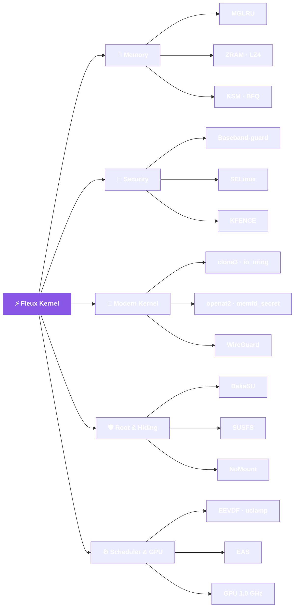

<div align="center">

# ⚡ 𝗙𝗟𝗘𝗨𝗫 𝗞𝗘𝗥𝗡𝗘𝗟

### A lean, modern, feature-packed kernel for the **POCO M4 Pro 4G** & **Redmi Note 11S 4G**

[](https://gitlab.com/daliboss/fleux/-/releases)
[](https://kernel.org)
[](#-device-support--compatibility)
[](#-device-support--compatibility)
[](COPYING)

**Modern EEVDF scheduler · smarter memory · GPU boost · hardened root**

[📦 Releases](https://gitlab.com/daliboss/fleux/-/releases) ·
[📜 Source](https://gitlab.com/daliboss/fleux/-/commits/lineage-24.0) ·
[🐞 Issues](https://gitlab.com/daliboss/fleux/-/issues)

</div>

---

## 🚀 What is Fleux?

**Fleux** is a custom Android kernel that keeps the stock MediaTek hardware stack
untouched and layers modern, battle-tested kernel features on top — so your phone
multitasks better, stays compatible with modern apps & root tools, and keeps
critical partitions safe from rogue writes.

> No BSP forks. No device-tree churn. Just a clean, auditable feature layer on a
> stable **Linux 4.19.325** base.

<div align="center">



</div>

---

## ✨ Feature Highlights

<table>
<tr>
<td width="50%" valign="top">

### 🧠 Memory & Performance

- **Multi-Gen LRU (MGLRU)** — smarter page reclaim so foreground apps survive
  memory pressure
- **ZRAM** with **LZ4** compression
- **KSM** — Kernel Samepage Merging
- **BFQ** — Budget Fair Queueing I/O scheduler
- **UCLAMP** — utilization clamping for better task placement

</td>
<td width="50%" valign="top">

### 🧩 Modern Kernel Surface

- **`clone3`** — with `CLONE_CLEAR_SIGHAND` & stack validation
- **`io_uring`** — high-performance async I/O
- **`openat2`** · **`faccessat2`**
- **`memfd_secret`** · **`pidfd_getfd`** · **`waitid(P_PIDFD)`**
- **PSI** · **fs-verity** · **EROFS** (with compression)

</td>
</tr>
<tr>
<td width="50%" valign="top">

### 🛡️ Security

- **Baseband-guard (BBG)** — LSM that blocks unauthorized writes to baseband /
  critical partitions *(boot & recovery stay writable)*
- **SELinux** enforcement
- **KFENCE** — lightweight memory-safety detector
- **BPF** hardening backports

</td>
<td width="50%" valign="top">

### 👑 Root, Hiding & Networking

- **BakaSU** — KernelSU fork with **multi-manager** support
- **SUSFS** — deep root hiding (uname spoof, path / mount / kstat hiding, cmdline/bootconfig spoof)
- **NoMount** — VFS path redirection
- **WireGuard** — fast in-kernel VPN
- **DroidSpaces-ready** config (namespaces, cgroups, netfilter)

</td>
</tr>
<tr>
<td width="50%" valign="top">

### ⚙️ CPU Scheduler

- **EEVDF** — modern Earliest-Eligible-Virtual-Deadline-First pick/preempt
  policy, **default-on** (replaces the CFS pick path)
- **uclamp** — utilization clamping for better task placement, including the
  upstream `UCLAMP_FLAG_IDLE` fix
- **EAS** — Energy-Aware Scheduling task placement (energy model registered)

</td>
<td width="50%" valign="top">

### 🎮 GPU

- **GPU top OPP** — runs at **1.00 GHz**
- VCO kept low via post-divider 2; **voltage unchanged** (EEM-owned)
- Measured hardware clock ceiling ≈ **1.004 GHz** — 1.00 GHz chosen for margin

</td>
</tr>
</table>

---

## 📱 Device Support & Compatibility

| Device | Codename | SoC | Support |
| :-- | :--: | :-- | :--: |
| 🟠 **POCO M4 Pro 4G** | `fleur` | MediaTek Helio G96 (MT6781) | ✅ Primary |
| 🔴 **Redmi Note 11S 4G** | `miel` | MediaTek Helio G96 (MT6781) | ✅ Supported |

- **Android:** 13 → 17 *(installer-enforced range)*
- **Bootloader:** must be **unlocked**
- **Slots:** **A/B** — the installer flashes the active slot and aborts safely if
  it can't be determined
- **Safety:** installer verifies `fleur` / `miel` and aborts on any mismatch

---

## 📦 Releases

All builds are published on the **[Releases page](https://gitlab.com/daliboss/fleux/-/releases)**
as flashable AnyKernel3 ZIPs — download the **latest**, or any previous version.

➡️ **Get the latest build:** https://gitlab.com/daliboss/fleux/-/releases

> ⚙️ **Modern scheduler & GPU:** EEVDF + uclamp task scheduling (default-on),
> EAS energy-aware placement, and a **1.00 GHz** GPU top OPP.

---

## 🔧 Installation

> ⚠️ **Back up your `boot` partition first!**
> The AnyKernel3 installer does **not** create a backup. Keep a known-good image
> so you can always recover via fastboot.

1. Download the **latest release ZIP** from the [Releases page](https://gitlab.com/daliboss/fleux/-/releases).
2. Reboot into a custom recovery (TWRP / OrangeFox) **or** open a KernelSU/BakaSU manager.
3. Flash the ZIP. The installer will:
   - ✅ verify your device (`fleur` / `miel`)
   - ✅ detect and target the **active A/B slot**
   - ✅ write **only the `boot` partition** *(`dtbo` / `vendor_boot` are untouched)*
4. Reboot and confirm:

```bash
uname -r
# 4.19.325-Fleux
```

> 🧯 **Recovery:** if it doesn't boot, `fastboot boot <known-good.img>` or reflash a
> boot image to the active slot from fastboot.

<details>
<summary><strong>What exactly does the installer touch?</strong></summary>

Fleux ships as a standard **AnyKernel3** package. The bundled `write_boot` logic
*would* flash `vendor_boot`, `vendor_kernel_boot`, `vendor_dlkm`, and `dtbo` **if
those images were present** — but a Fleux ZIP contains **only `Image.gz-dtb`**, so
those steps are skipped and **only the `boot` partition** is written.

</details>

---

## 🛠️ Building from Source

**Toolchain:** Android LLVM/Clang **`r563880c`** (Clang 21, LLD) + `aarch64`/`arm` cross toolchains.

```bash
export PATH=$HOME/tc21/clang-r563880c/bin:$PATH
export ARCH=arm64 SUBARCH=arm64
export KBUILD_BUILD_USER=dali KBUILD_BUILD_HOST=boss

# 1) Configure
make O=out fleur_defconfig \
  CC=clang LD=ld.lld LLVM=1 LLVM_IAS=1

# 2) Build
make -j$(nproc) O=out \
  CC=clang LD=ld.lld LLVM=1 LLVM_IAS=1 \
  CLANG_TRIPLE=aarch64-linux-gnu- \
  CROSS_COMPILE=aarch64-linux-gnu- \
  CROSS_COMPILE_ARM32=arm-linux-gnueabi-
```

📤 **Output:** `out/arch/arm64/boot/Image.gz-dtb`

---

## 🧪 Verification & Known Behavior

Fleux is honest about what's proven:

| ✅ Confirmed active | ⚠️ Available, not default | 🔬 Enabled, not benchmarked |
| :-- | :-- | :-- |
| MGLRU | **BFQ** (boot dev runs `mq-deadline`) | KFENCE |
| ZRAM (LZ4) | **KSM** (`run = 0`) | EEVDF / EAS scheduling quality |
| All backported syscalls | | Sustained GPU FPS & thermals @ 1.0 GHz |
| **EEVDF** scheduler · **uclamp** · **EAS** | | Battery / RAM gains |
| **GPU top OPP 1.00 GHz** (locks, 0 asserts) | | |
| BakaSU · SUSFS · NoMount · BBG | | |

- 🔗 **Syscalls** are wired for ARM64 in `asm-generic/unistd.h` **and** present as
  `__arm64_sys_*` in the running kernel.
- 🧠 **MGLRU / KSM / ZRAM** are live via `/sys/kernel/mm/...` and `/sys/block/zram0`.
- ⚙️ **EEVDF** is the live scheduler: `sched_latency_ns` / `sched_wakeup_granularity_ns`
  are gone and `sched_min_granularity_ns` is the base slice.
- ⚡ **EAS** is active (`/proc/sys/kernel/sched_energy_aware = 1`) with the MTK
  energy model registered (`em_register_perf_domain`).
- 🎮 **GPU top OPP** runs at **1.00 GHz**: verified on-device, it pins at a real
  **1,000,000 kHz** with **zero** clock-switch asserts; the hardware ceiling is ≈ 1.004 GHz.
- 🛡️ **Baseband-guard** is actively evaluating processes by SELinux domain
  (visible in `dmesg`).
- 🕵️ **SUSFS cmdline spoof** is wired on the read path and verified on-device:
  with a spoof file set, `/proc/cmdline` reports `verifiedbootstate=green`
  (the rest of the real line is preserved).
- 📵 **Hardware** (camera, torch, touch, audio, charging, Wi-Fi/BT) uses the
  **inherited stock drivers** — unchanged by Fleux.

> ❗ **Not claimed:** the GPU top OPP is a *measured clock frequency*, **not** a
> benchmarked FPS/thermal gain; and no battery or RAM-efficiency improvements are
> asserted — those are not benchmarked.

---

## 🛡️ Root & Hiding Stack

| Component | Role |
| :-- | :-- |
| **BakaSU** | KernelSU fork · multi-manager support |
| **SUSFS** | `SPOOF_UNAME`, `SUS_PATH`, `SUS_MOUNT`, `SUS_KSTAT`, `OPEN_REDIRECT`, `SPOOF_CMDLINE_OR_BOOTCONFIG`, symbol hiding |
| **NoMount** | VFS dentry/path redirection for deeper concealment |
| **Baseband-guard** | Block-write guard — boot & recovery stay writable |

### 🕵️ Command-line spoofing

SUSFS can present a fake `/proc/cmdline` to readers, so boot-state markers
(`verifiedbootstate`, `flash.locked`, `vbmeta.device_state`, …) report a
locked / green device. Fleux wires the read path and ships:

- [`docs/susfs/fake_cmdline.example.txt`](docs/susfs/fake_cmdline.example.txt) — sanitized template (no device identifiers)
- [`docs/susfs/read_cmdline.sh`](docs/susfs/read_cmdline.sh) — prints the spoof-relevant `androidboot.*` fields

Set the fake-file path in your root manager (**BakaSU → SUSFS → Cmdline /
Bootconfig**); it applies live and is re-applied on boot. This only affects
`/proc/cmdline` readers — `ro.boot.*` properties are unchanged.

---

## 🙏 Credits & Upstream

- **Linux kernel** & **AOSP** — the base everything stands on
- **MediaTek** — vendor BSP, device tree & hardware drivers *(inherited)*
- **MGLRU** — Yu Zhao *et al.*
- **EEVDF** — Peter Zijlstra *et al.* (backported to 4.19)
- **KFENCE**, **io_uring**, **WireGuard** and the backported syscalls — upstream authors
- **KernelSU / BakaSU**, **SUSFS**, **NoMount**, **DroidSpaces** — their projects
- **AnyKernel3** — osm0sis *(packaging)*
- **Toolchain** — Android LLVM `r563880c`

---

## ⚖️ Disclaimer & License

> Flashing a custom kernel carries risk — including data loss and bricking.
> **You** are responsible for backing up your device and flashing at your own risk.
> Fleux is provided **"as is"**, without warranty of any kind.

**Licensed under [GPL-2.0](COPYING).** See [`LICENSES/`](LICENSES) for the full
license tree. All upstream components remain under their original licenses.

<div align="center">

**⚡ Made with care for `fleur` & `miel`**

*If Fleux makes your device better, drop a ⭐ on the repo!*

</div>
